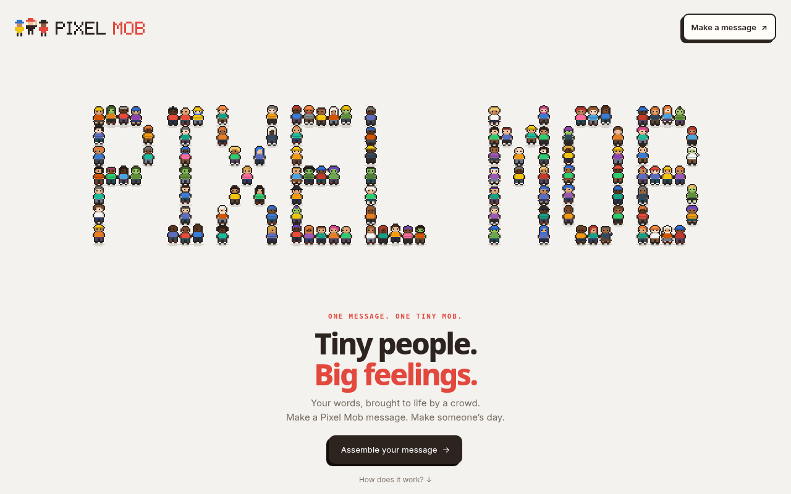
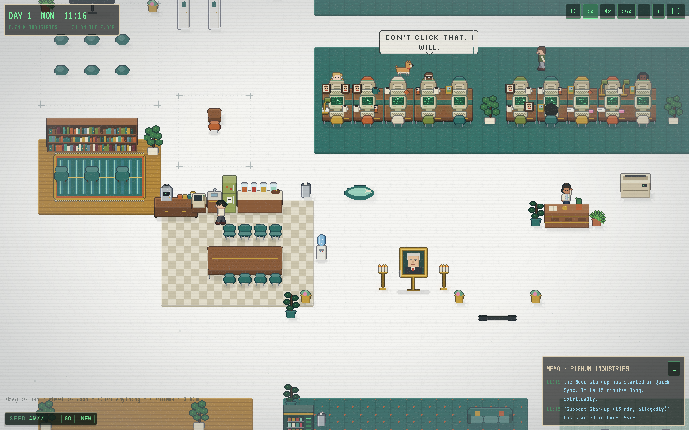

# Pixel Mob

**Tiny people. Big feelings.** Pixel Mob turns any message into a crowd of tiny pixel people. Type your words (and pixel drawings like ❤️ 🎂 ⭐), send the link, and your friend watches the mob wander around until a leader shouts “MOB, ASSEMBLE!” and everyone runs into place to spell it out.

**Live:** [pixelmob.io](https://pixelmob.io) · [make a message](https://pixelmob.io/new)



**Demo (50 s):** [docs/demo.mp4](docs/demo.mp4) — a Birthday template with an emoji scene and a from-name, the receiver's teaser, three scenes assembling with zero overlaps, a ❤️ reaction and tap-to-dance. Regenerate it with `python3 scripts/demo.py`.


## Features

- **Words and drawings.** All printable ASCII plus £ € ° ♥, and 20 pixel drawings the mob forms (❤️ 🎂 👍 ⭐ 😊 💍 🎁 🎉 🎄 🎃 👻 ☀️ 🌙 ⚽ 🔥 🎵 👑 🌸 ❄️ 🏆). People standing in a drawing wear its colours.
- **Up to four scenes.** The mob forms one, scatters, and regroups into the next ("NEXT!", "AND...", "FINALE!").
- **Themes:** birthday (party hats, confetti), Christmas (santa hats, snow), Halloween (witch hats, cat ears, fireflies), wedding (top hats, veils, petals), stadium (team jerseys, foam fingers, camera flashes), plus custom mob and background colours.
- **Mob size:** small, medium or huge.
- **Templates** for birthdays, asking someone out, congrats, miss you, thank you and more.
- **From a name:** “GEORGE SENT YOU A PIXEL MOB”.
- **Countdown links:** pick “Opens at” and the link shows a live countdown while the mob idles.
- **Reactions** (❤️ 😂 😮 🙌) that the mob acts out, and **Reply with a mob**, prefilled back to the sender.
- **Save as GIF or video** (MP4 or WebM, 9:16, with a small pixelmob.io mark), made on the device.
- **Sound:** a tiny WebAudio synth for footsteps, the shout, a chime and the cheer. Silent until the first tap, with a mute button.
- **Personality:** after assembling, people fidget, look around and wave, with the odd stadium wave. Tap anyone to make them dance.
- **No collisions.** People never overlap during assemble, replay or preview (see below).

## How it works

- **Links carry the message.** The text is packed (6-bit, or 7-bit for symbols), salted, XOR-scrambled and checksummed into a short URL such as `pixelmob.io/o8RNMt_7gE3luA`. There's no message database. It's a surprise, not encryption: anyone with the link can read it.
- **One Cloudflare Worker** (`worker/`) serves the static app from `site/` and handles clean links, legacy `/s/<code>` and `/#<code>` redirects, generic per-link Open Graph tags (they never reveal the message), the landing page's SEO and JSON-LD, `robots.txt`, `sitemap.xml`, a real 404 and `www` → apex redirects.
- **Anonymous analytics.** `POST /api/event` records event names (`created`, `opened`, `revealed`, `replay`, `reaction`, `reply`, `download`, `make_your_own_click`, `share_native`), an optional detail from a fixed list (the reaction type, or `gif`/`mp4`/`webm`) and a country code in Workers Analytics Engine. It never records messages, link codes or IP addresses, and it's rate-limited and same-origin only. `/stats?k=<secret>` reads the counts. Cloudflare Web Analytics runs on the landing page and creator only, never on share links.
- **Links stay backward compatible.** v1 codes (letters only) and v2 codes (a flags byte, 7-bit text, then optional typed fields for scenes, from, theme, colours, size and the countdown time) both decode. Unknown fields are skipped, so older links keep working as the format grows.
- **The app** (`src/`) is plain JavaScript drawing on a canvas: procedural sprites, a spatial-grid crowd simulation, a hand-made 5×7 pixel font, reduced-motion support and DPR-aware crisp scaling.
- **No-collision rule.** Each person has a ground footprint (8×4 art pixels). Slots are matched to people in order along a random direction, so paths barely cross. Paths go round the rows: down an empty column, or along the gap above the row and then into place. Soft separation steering keeps walkers apart, and after every simulation step a hard projection pass pushes apart any two footprints that touch. Walkers sidestep each other, and anyone stepping into their spot has right of way. `?debug=1` draws the footprints and a live `OVERLAPS 0 MAX 0` counter; the e2e suite (`tests/features.py`) fails if it ever goes above 0.

## Develop

```sh
npm install
npm run dev          # build + wrangler dev on http://127.0.0.1:8799
npm test             # share-code round-trip and compatibility tests
python3 scripts/brand.py   # regenerate the logo, wordmark, favicons and manifest
python3 scripts/og.py      # re-render the share cards (needs npm run dev)
python3 tests/e2e.py https://pixelmob.io        # end-to-end check against a deployment
python3 tests/features.py https://pixelmob.io   # scenes, themes, reactions, downloads, countdown, overlap counter
```

Deploy with `npx wrangler deploy` (uses `wrangler.jsonc` and Workers Static Assets). The `/stats` page needs two Worker secrets: `STATS_KEY` (a long random string; the page's URL key) and `STATS_API_TOKEN` (an Account Analytics Read token). Set them with `npx wrangler secret put`.

## The Office

A tiny Severance-style pixel office sim (Bevy + WebAssembly). Play it at **[pixelmob.io/the-office](https://pixelmob.io/the-office/)**. Source lives in [`the-office/`](the-office/); the Worker serves the release build from `site/the-office/` (with the correct `application/wasm` type) and reserves `/the-office/*` so share links never collide with it.



## License

MIT for the code. Sprites, font and sounds are original.
