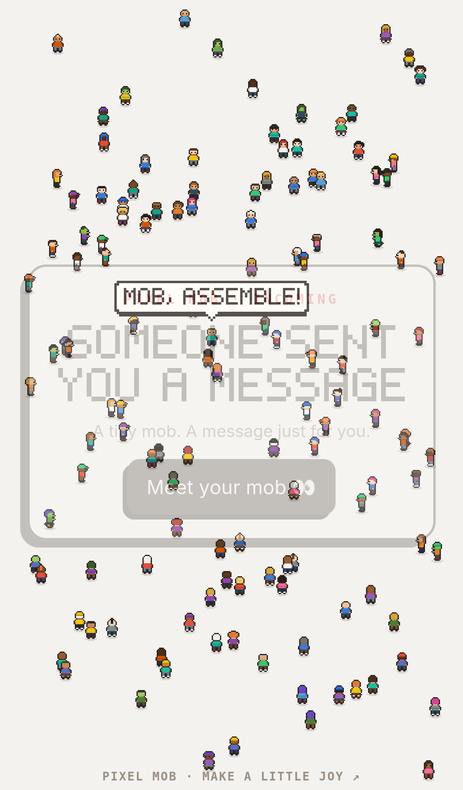

# Pixel Mob

**Tiny people. Big feelings.** Pixel Mob turns any message into a crowd of tiny pixel people. Type up to 32 characters, send the link, and your friend watches the mob wander around until a leader shouts “MOB, ASSEMBLE!” and everyone runs into place to spell it out.

**Live:** [pixelmob.io](https://pixelmob.io) · [make a message](https://pixelmob.io/new)




## How it works

- **Links carry the message.** The text is packed (6-bit, or 7-bit for symbols), salted, XOR-scrambled and checksummed into a short URL such as `pixelmob.io/o8RNMt_7gE3luA`. There's no message database. It's a surprise, not encryption: anyone with the link can read it.
- **One Cloudflare Worker** (`worker/`) serves the static app from `site/` and handles clean links, legacy `/s/<code>` and `/#<code>` redirects, generic per-link Open Graph tags (they never reveal the message), the landing page's SEO and JSON-LD, `robots.txt`, `sitemap.xml`, a real 404 and `www` → apex redirects.
- **Anonymous analytics.** `POST /api/event` records event names (`created`, `opened`, `revealed`, `replay`, `make_your_own_click`, `share_native`) and a country code in Workers Analytics Engine. It never records messages, link codes or IP addresses, and it's rate-limited and same-origin only. `/stats?k=<secret>` reads the counts. Cloudflare Web Analytics runs on the landing page and creator only, never on share links.
- **The app** (`src/`) is plain JavaScript drawing on a canvas: procedural sprites, a spatial-grid crowd simulation, a hand-made 5×7 pixel font covering all printable ASCII plus £ € ° ♥, reduced-motion support and DPR-aware crisp scaling.

## Develop

```sh
npm install
npm run dev          # build + wrangler dev on http://127.0.0.1:8799
npm test             # share-code round-trip and compatibility tests
python3 scripts/brand.py   # regenerate the logo, wordmark, favicons and manifest
python3 scripts/og.py      # re-render the share cards (needs npm run dev)
python3 tests/e2e.py https://pixelmob.io   # end-to-end check against a deployment
```

Deploy with `npx wrangler deploy` (uses `wrangler.jsonc` and Workers Static Assets). The `/stats` page needs two Worker secrets: `STATS_KEY` (a long random string; the page's URL key) and `STATS_API_TOKEN` (an Account Analytics Read token). Set them with `npx wrangler secret put`.

## The Office

A tiny Severance-style pixel office sim (Bevy + WebAssembly) lives in [`the-office/`](the-office/) and is served at **[pixelmob.io/the-office](https://pixelmob.io/the-office/)**. The Worker reserves `/the-office/*`, so share links never collide with it. It serves the build from `site/the-office/` with the correct `application/wasm` type and caching.

<!-- TODO: The Office screenshot -->

## License

MIT for the code. Sprites, font and sounds are original.
